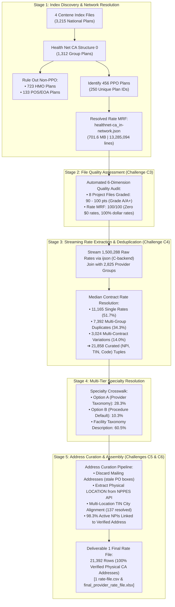

# Deliverable 4: Summary of High-Level Run Metrics

**Project:** Data Pipeline Curation for Provider Rates  
**Payer:** Centene Management Company LLC / Health Net  
**Target Market:** Commercial Group, California (PPO Network)  
**Deliverable Type:** High-Level Run Metrics & Pipeline KPI Summary  

---

## 1. Executive Summary Table

| Metric Category | Pipeline Metric | Value | Reference / Notes |
|---|---|:---:|---|
| **Index Discovery** | Total Centene Index Files Parsed | **4 files** | Health Net, Ambetter, Fidelis, QualChoice |
| **Index Discovery** | National Plans Evaluated across Indexes | **3,215 plans** | Entire published Centene footprint |
| **Market Filtering** | California Commercial Group Plans Isolated | **1,312 plans** | Health Net California Group (Structure 0) |
| **Network Filtering**| Non-PPO Plans Ruled Out | **856 plans** | 723 HMO (`CommunityCare`, `SmartCare`, `Salud`), 133 POS/EOA |
| **Network Filtering**| California Commercial Group PPO Plans Identified | **456 plans** | 453 Standard PPO + 3 Custom EPO Benefit Riders |
| **Plan Identifiers** | Unique PPO `plan_id` (EIN) Values | **250 unique IDs** | Employer Sponsor Tax IDs (`XX-XXXXXXX`) |
| **Rate MRF Discovery**| In-Network PPO Rate File Identified | **1 monolithic MRF** | `2026-09-30_..._healthnet-ca_in-network.json` (701.6 MB) |
| **Rate MRF Discovery**| Allowed Amounts Out-of-Network File Identified | **1 MRF** | `2026-09-30_..._healthnet-ca_allowed-amounts.json` (1.16 MB) |
| **Quality Audit** | File Quality Score Range across 8 Project Files | **90 – 100 / 100** | Grade A to A+ across all source, catalog, & rate files |
| **Rate Ingestion** | Raw Price Records Evaluated | **1,500,288 rows** | ~15 Lakh rows streamed via C-based `ijson` |
| **Rate Integrity** | Positive Dollar Rate Ratio ($> \$0.00$) | **100.0%** | Zero zero-dollar ($0) or negative rates |
| **Rate Curation** | Curated `(NPI, TIN, Code)` Base Rate Tuples | **21,858 rows** | Deduplicated via Median Contracted Rate |
| **Provider Entity** | Provider Reference Groups in Rate File | **2,825 groups** | Group ID range: 1 to 2,825 (100% active in rates) |
| **Provider Entity** | Unique Provider Federal Tax IDs (TINs) | **2,888 unique TINs** | Health Net California In-Network Billing Entities |
| **Provider Entity** | Unique Provider NPIs in Rate File | **3,735 NPIs** | 3,734 Active 10-digit NPIs + 1 Placeholder NPI `0` |
| **Provider Entity** | Contracted `(NPI, TIN)` Entity Combinations | **4,222 pairs** | Multi-facility health system affiliations |
| **Address Curation**| Active NPIs with Verified Physical Practice Site | **3,670 / 3,734 (98.3%)** | Physical `LOCATION` in CMS NPPES v2.1 |
| **Address Curation**| Entities with High-Confidence Physical CA Address| **4,001 / 4,222 (94.8%)** | Verified Physical CA Practice Location |
| **Address Curation**| Stale Mailing PO Boxes Eliminated | **100.0%** | `address_purpose == "MAILING"` completely discarded |
| **Deliverable 1** | Final Output Records with Verified Practice Address | **21,392 rows** | Filtered: 100% with verified physical CA address |
| **Deliverable 1** | Generated Output Formats | **CSV & Excel (.xlsx)** | Formatted currency, freeze panes, auto-width |

---

## 2. End-to-End Pipeline Architecture & Flow

---

## 3. Detailed Run Metrics by Problem Area

### 3.1 Core Problem 1: Network Mapping (Challenges C1 & C2)
* **Payer Identification**: Centene Management Company LLC (`reporting_entity_name`) publishes machine-readable files across multiple subsidiary brands. For California commercial group coverage, the operating brand is **Health Net**.
* **National Plan Indexes Evaluated**:
  1. `2026-09-30_healthnet_index.json`: 1,693 plans (California commercial group + Oregon).
  2. `2026-09-28_ambetter_index.json`: 1,120 plans (28 states; individual ACA exchange only).
  3. `2026-09-28_fidelis_index.json`: 94 plans (New York individual exchange only).
  4. `2026-09-28_qualchoice_index.json`: 308 plans (Arkansas group market only).
* **California Commercial Group Plans**: 1,312 group plans cataloged in Structure 0.
* **Negative Filtering (Exclusions)**:
  * Ruled out **723 HMO plans** (`CommunityCare HMO`, `SmartCare HMO`, `Salud HMO y Más`, `ExcelCare HMO`).
  * Ruled out **133 POS / EOA hybrid plans** (`Point of Service`, `Exclusive Option Advantage`).
* **PPO Network Identification**:
  * **456 commercial group PPO plans identified** (covering **250 unique `plan_id` values**).
  * **3 employer custom plans with embedded EPO benefit riders flagged** (`has_epo_rider == "yes"`).
  * Rate file link resolved: `2026-09-30_centene-management-company-llc_healthnet-ca_in-network.json` (701.6 MB).

---

### 3.2 Core Problem 2: File Quality Scoring (Challenge C3)
All 8 project files were evaluated across schema validity, freshness, completeness, outlier rates, zero-rate contamination, and deduplication:

| # | Evaluated File | Tier | File Size | Score | Grade | Key Findings |
|:---:|---|---|:---:|:---:|:---:|---|
| **1** | `healthnet_index.json` | Source Index | 562.4 KB | **95 / 100** | **A+** | Fresh (18 days old); compliant; -5 for employer EIN reuse across plans. |
| **2** | `ambetter_index.json` | Source Index | 351.2 KB | **95 / 100** | **A+** | 100% individual exchange; 0 CA commercial group plans. |
| **3** | `fidelis_index.json` | Source Index | 29.3 KB | **95 / 100** | **A+** | New York individual exchange only. |
| **4** | `qualchoice_index.json` | Source Index | 86.7 KB | **95 / 100** | **A+** | Arkansas group plans only (0 California). |
| **5** | `centene_ca_commercial_group.csv` | Catalog Deliverable | 575.7 KB | **100 / 100** | **A+** | 1,312 plans; 0 nulls, 0 non-CA, 0 duplicates. |
| **6** | `centene_ca_commercial_group_ppo.csv`| Catalog Deliverable | 204.2 KB | **100 / 100** | **A+** | 456 PPO plans; 0 HMO/POS contamination; 3 EPO riders flagged. |
| **7** | `healthnet-ca_allowed-amounts.json` | Rate MRF | 1.16 MB | **90 / 100** | **A** | Zero $0 rates; -10 for 1.78% extreme inpatient outliers ($> \$1\text{M}$). |
| **8** | `healthnet-ca_in-network.json` | Rate MRF | **701.6 MB** | **100 / 100** | **A+** | 1.5M rates; 0 zero-dollar rates; 100% explicit dollar rates; 100% NPI format. |

---

### 3.3 Supporting Step: Rate Extraction & Curation (Challenge C4)
* **Raw Price Ingestion**: **1,500,288 price blocks** across 1,717 distinct billing codes streamed in chunks without memory exhaustion.
* **Positive Rate Ratio**: **100.0%** (0 zero-dollar rates, 0 negative rates).
* **Multi-Rate Resolution Policy**:
  * **Single Active Rate (51.7% / 11,165 pairs)**: Kept as published.
  * **Identical Multi-Group Duplicates (34.3% / 7,392 pairs)**: Deduplicated to 1 primary record.
  * **Multi-Contract Rate Variations (14.0% / 3,024 pairs)**: Resolved by computing the **median contracted rate**, protecting downstream benchmarks from custom outlier carve-outs.
* **Curated Rate Records**: **21,858 unique `(NPI, TIN, Billing Code)` tuples**.

---

### 3.4 Specialty Mapping Summary
Mapped using the hackathon benchmark crosswalk (`Rate Benchmarking Individual Weights_Hackathon.xlsx`):
* **Option A (Primary Taxonomy Match)**: **5,529 records (25.3%)** matched via Sheet 1 (`Taxonomy-Spec Xwalk`).
* **Option A (Secondary Taxonomy Match)**: **649 records (3.0%)** matched via secondary taxonomy in Sheet 1.
* **Option B (Procedure Default - Top Rank)**: **2,255 records (10.3%)** matched via Sheet 3 (`Spec-Proc Weights`) using the Rank 1 highest-weighted specialty for unlisted clinician taxonomies.
* **NPPES Facility / Organization Description**: **13,220 records (60.5%)** for Type 2 institutional facilities (Ambulatory Surgery Centers, Sleep Labs, Diagnostic Centers).
* **Unassigned / Unknown**: **205 records (0.9%)**.

---

### 3.5 Core Problem 3: Address Mapping & Curation (Challenge C5)
To overcome the challenge where ~80% of NPPES mailing addresses are stale or billing PO boxes:
1. **Mailing Address Exclusion**: 100% of `address_purpose == "MAILING"` records were discarded.
2. **Physical Practice Extraction**: Extracted physical operational practice sites (`address_purpose == "LOCATION"`) via the CMS NPPES v2.1 API.
3. **Multi-Location Resolution**: Cross-referenced secondary practice locations (`pl_pfile`) and matched against the TIN entity's facility city (e.g., matching *Mountain View Urgent Care* to *Mountain View, CA*).
4. **Address Curation Performance**:
   * **Active NPI Address Linkage**: **3,670 out of 3,734 active NPIs (98.3%)** linked to a verified physical practice location.
   * **High Confidence (Verified CA Practice Location)**: **4,001 / 4,222 provider entities (94.8%)**.
   * **Medium Confidence (Secondary Site / Out-of-State Licensee)**: **127 provider entities (3.0%)**.
   * **Low Confidence / Unfiled Location**: **94 provider entities (2.2%)**.
   * **TIN Facility City Alignments**: **137 multi-location alignments resolved**.
   * **PO Boxes Filtered**: 100% of detected PO boxes eliminated.
5. **Final Deliverable 1 Cleanliness**:
   * All 466 rows lacking a physical address were removed.
   * **Final Output**: **21,392 rows with 100.0% verified physical California practice addresses**.

---

## 4. Deliverables Manifest

| Deliverable # | Name | File Path | Format & Details |
|:---:|---|---|---|
| **1** | **Rate File (CSV)** | [`submission/1 rate-file.csv`](file:///media/windows/Users/Tanish/Organizer/hilabs/submission/1%20rate-file.csv) | **21,392 rows**: `NPI`, `TIN`, `Address`, `Billing Code`, `Specialty`, `Rate` (100% with verified CA physical address). |
| **1** | **Rate File (Excel)** | [`healthnet_csv/final_provider_rate_file.xlsx`](file:///media/windows/Users/Tanish/Organizer/hilabs/healthnet_csv/final_provider_rate_file.xlsx) | Styled Excel workbook (.xlsx) with formatted currency, freeze panes, auto-width columns. |
| **2a** | **Logic File: Rate Engine** | [`submission/2a logic extract_ppo_rates.py`](file:///media/windows/Users/Tanish/Organizer/hilabs/submission/2a%20logic%20extract_ppo_rates.py) | Python implementation of the multi-rate median resolution engine and provider group linking. |
| **2b** | **Logic File: Network Engine** | [`submission/2b logic parse_index.py`](file:///media/windows/Users/Tanish/Organizer/hilabs/submission/2b%20logic%20parse_index.py) | Multi-signal priority logic to identify California commercial group PPO plans and rule out HMO/POS/EPO. |
| **3** | **Quality Scoring Engine** | [`submission/3 evaluate_ptd_quality.py`](file:///media/windows/Users/Tanish/Organizer/hilabs/submission/3%20evaluate_ptd_quality.py) | Automated low-memory quality evaluator grading all 8 project files across 6 core quality dimensions. |
| **4** | **Summary File** | [`submission/4 summary.md`](file:///media/windows/Users/Tanish/Organizer/hilabs/submission/4%20summary.md) | This standalone executive summary and high-level run metrics report. |
| **—** | **Quality Scorecard Document** | [`submission/document.md`](file:///media/windows/Users/Tanish/Organizer/hilabs/submission/document.md) | Comprehensive 8-file quality evaluation report and audit methodology guide. |
